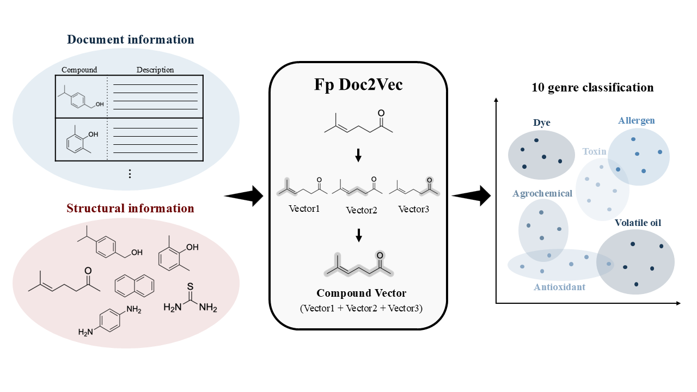
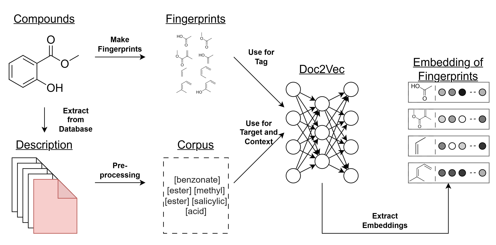
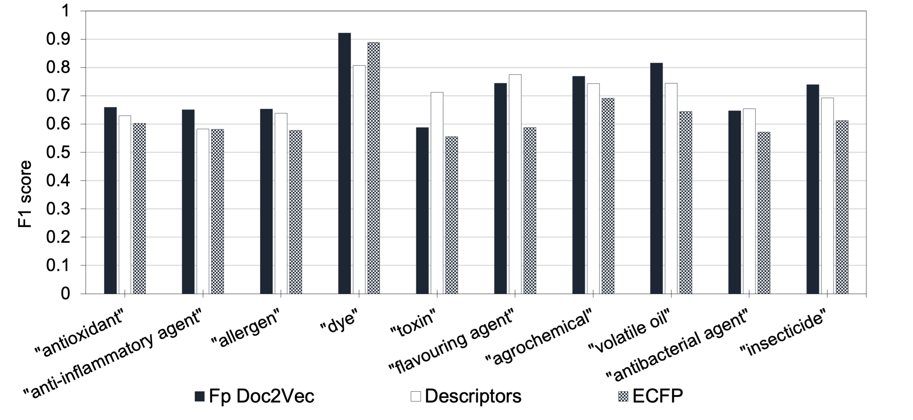
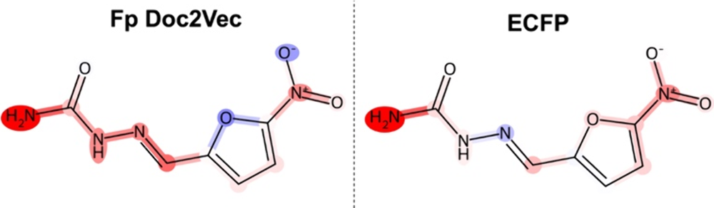

　
## 0.  はじめに

こんにちは、横浜国立大学 五東研究室の小出です。

[POCLabリサーチハイライト](https://zenn.dev/p/poclab_techblog/lists/wy2nxzk6sg)では、横浜国立大学 五東研究室[POCLab](https://poclab-web.github.io/homepage/)の研究成果を紹介しています。

今回の第3回目の記事では、Journal of Chemical Information and Modeling (JCIM)に掲載された、**化合物の説明文と部分構造を組み合わせて、化合物の「化学的な役割」を予測する**研究を紹介します。

*図1:本研究の概要(Graphical Abstract) Reprinted with permission from [J. Chem. Inf. Model. 2026, DOI: 10.1021/acs.jcim.6c01643](https://doi.org/10.1021/acs.jcim.6c01643). © 2026 American Chemical Society.*

コードとデータは [GitHub](https://github.com/poclab-web/FpDoc2vec) と [Zenodo](https://doi.org/10.5281/zenodo.20064101) で公開しています。

## 1.  五東先生からのコメント

今回の研究は、2024年に松元君と発表した研究を、さらに発展させたものです。

もともとの研究は、「化学の論文には膨大な情報が蓄積されているのに、文章そのものを化合物の解析や予測にもっと活用できないだろうか？」という疑問から始まりました。ケモインフォマティクスでは、化学構造を数値化して解析することが一般的ですが、論文やデータベースに書かれた文章にも、化合物に関する多くの知識が含まれています。

第1報では、抗酸化能に関する論文を自然言語処理の一つであるWord2Vecによって解析し、化合物を分類するとともに、文章から得られた情報と分子の化学的特徴との間に関連があることを示しました。しかし、この段階では、文章から化合物の特徴を捉えられることは分かったものの、それを実際の予測に利用するところまでは進んでいませんでした。

そこで今回の研究では、対象を抗酸化物質からさらに広げ、化合物データベースに記載された説明文を利用して、化合物の役割そのものを予測することに挑戦しました。Doc2Vecという自然言語処理の手法を用いて文章を数値化し、機械学習と組み合わせることで、化合物がどのような役割を持つのかを予測するモデルを構築しました。第1報の「文章から化合物の特徴を読み取る」という研究から、「文章を使って化合物の役割を予測する」という研究へ発展させたことが、今回の重要な成果だと思います。

この研究で面白いのは、化学構造だけでなく、化合物について書かれた文章も予測に利用できるという点です。従来のケモインフォマティクスとは異なる情報を活用することで、化学構造だけでは捉えきれない化合物の特徴や役割を理解できる可能性があります。

また、第1報から今回の研究に至るまで、学生たちが研究を引き継ぎながら発展させてくれたこともうれしく思います。最初の研究で得られた成果をそのまま終わらせるのではなく、そこから新しい疑問を見つけ、次の研究につなげていくことは、研究を進めるうえで非常に重要です。松元君が取り組んだ研究を土台として、小出君が新しい課題に挑戦し、一つの論文としてまとめてくれたことに大きな意味があると思います。

近年は大規模言語モデルをはじめ、自然言語処理の技術が急速に発展しています。しかし、大切なのは新しい技術を利用すること自体ではなく、「その技術によって、これまで解決できなかった化学の問題を解決できないか」と考えることです。今回の研究も、まだ発展の余地が大きい分野だと思います。これからも化学と情報科学の両方の視点を大切にしながら、新しい問題を見つけ、挑戦してくれることを期待しています。

## 2. 研究の背景

創薬や材料探索分野では、機械学習の予測モデルを使ったスクリーニングが注目されています。ただ一方で、化学の多くの分野では、モデルの学習に十分な規模のデータセットが少ないという課題があります。

そこで注目されているのが、**自然言語処理(NLP)**で論文やデータベースの文章から知識を取り込むアプローチです。この文献知識を活用できれば、データが足りない分野でも予測の助けになります。

本研究の土台になった松元さんが取り組んだ研究[^1]もこのアプローチの一つです。この研究では、論文から得られた化合物の埋め込みと化合物の物性情報との間に相関があることを示しました。つまり、**文章を読むだけでも、化合物の特徴をある程度捉えられる**ことが分かったのです。

しかし、NLPを化学の予測に使うには、大きく2つの壁があります。

- **外挿の問題**: NLPモデルは、学習時に見た単語や文章にしか埋め込み(ベクトル)を割り当てられません。そのため、学習に使っていない未知の化合物には使えません。
- **解釈性の問題**: なぜその予測になったのか、どの部分構造が効いたのかを説明するのが難しく、LLMの推論は検証もしにくいという課題があります。

こうした壁があるため、テキストの知識を化学の予測に活かすのは簡単ではありません。そこで、**「テキストの知識を取り込みつつ、未知の化合物にも使えて、しかも解釈できる」表現が作れないか、**と考えたのが本研究のきっかけです。

## 3. 提案手法: Fp Doc2Vecについて

通常のDoc2Vecでは、文書(ここでは化合物の説明文)ごとに「タグ」を付け、タグに対応する埋め込みを学習します。化合物名をタグにすれば、化合物ごとの埋め込みが得られます。しかし、この方法では学習に使っていない化合物の埋め込みは作れません。

そこで **Fp Doc2Vec** では、化合物名の代わりに、その化合物が有する**部分構造(ECFPのビット)をタグ**として使います。これにより、学習に使っていない分子でもに対しても、含まれる部分構造の埋め込みを組み合わせることで表現できるようになります。本研究では以下の流れで化合物の埋め込み表現を作成しています。

1. PubChemから化合物の説明文を取得する
2. その化合物がもつ部分構造をタグにして、Doc2Vecで学習する(部分構造ごとの埋め込みを取得する)
3. **化合物に含まれる部分構造の埋め込みの総和**で、分子の埋め込み表現を表現する

*図2:Fp Doc2Vec手法の概念図。 Reprinted with permission from [J. Chem. Inf. Model. 2026, DOI: 10.1021/acs.jcim.6c01643](https://doi.org/10.1021/acs.jcim.6c01643). © 2026 American Chemical Society.*

本手法には、主に3つの利点があります。

- **説明文がなくても、構造さえあれば埋め込みが作れる点**
 学習範囲外の化合物でも、含まれる部分構造の埋め込みを足し合わせれば表現することができます。予測時にテキストは不要です。

- **大規模なデータや計算資源を必要としない点**
 近年主流のTransformer系は大きなデータセットと多くの計算コストを必要とする一方で、本手法は3万件の説明文のみで手法の有効性を確認しました。加えて、土台のDoc2Vecモデルは学習も非常に軽く、GPUのような計算環境は必要ありません。

- **実装がシンプルな点**
 Doc2Vecの学習はライブラリ(gensimなど)を使えば数行のコードで書けます。Transformer系のモデルに比べて調整すべきハイパーパラメータも少ないため、手軽に再現・応用できます。

## 4. 結果

ここでは、本研究の主な結果として、**① 未知の化合物への予測性能**と、**② SHAPによる重要度解析**の2つを紹介します。この2つは、先ほど挙げた「外挿の問題」と「解釈性の問題」にそれぞれ対応しています。

### ① 学習に用いていない化合物に対する役割予測

学習に用いていない化合物について、説明文を使わず**構造だけ**から、10種類の役割の分類予測を行いました。特徴量として、Fp Doc2Vecで得た埋め込み、ECFP、化学記述子(RDKit)の3種類を用意し、それぞれの予測性能を比較しました。

結果、10役割の平均F1スコアは、**Fp Doc2Vecが最も高く、化学記述子(RDKit)とECFPを上回りました。** 役割ごとに見ると、毒素・香料・抗菌剤では化学記述子が上回りましたが、残りの7つの役割ではFp Doc2Vecが最も高いF1スコアを示しました。

*図3:学習に用いていない化合物に対する予測性能の比較。 Reprinted with permission from [J. Chem. Inf. Model. 2026, DOI: 10.1021/acs.jcim.6c01643](https://doi.org/10.1021/acs.jcim.6c01643). © 2026 American Chemical Society.*

### ② SHAPによる重要度解析

予測の根拠を解釈するため、Fp Doc2VecとECFPのそれぞれについて、SHAPを用いて各部分構造が予測にどの程度寄与したのかを算出しました。さらに、その寄与の大きさを化合物の構造式上に色で示し、両者を比較しました。

結果、ケンフェロール(抗酸化剤)やニトロフラゾン(抗菌剤)では、FpDoc2vecの解釈のみが先行研究の知見[^2][^3]と一致する傾向が確認できました。

*図4:SHAP値を構造式(ニトロフラゾン)に反映した例(左:Fp Doc2Vec、右:ECFP)。 Reprinted with permission from [J. Chem. Inf. Model. 2026, DOI: 10.1021/acs.jcim.6c01643](https://doi.org/10.1021/acs.jcim.6c01643). © 2026 American Chemical Society.*

## 5. 最後に

最後まで読んでいただき、ありがとうございました。

この記事を読んで少しでも興味を持っていただいた方は、[本論文](https://doi.org/10.1021/acs.jcim.6c01643)も読んでいただけるとすごく嬉しいです。
コードとデータは公開していますので、ぜひ手元で試してみてください。ご意見やご質問もお待ちしています。

松元さん、五東先生をはじめ、研究室の多くの方々の助言と支えがあったからこそ、このような形で論文を投稿することができました。本研究に関わってくださったみなさんに、この場を借りてお礼を申し上げます。

さらに、学会では、企業・大学を問わず、非常に多くの方々からアドバイスをいただきました。いただいた意見は大きな刺激になり、自分の視野を広げることにもつながりました。本当にありがとうございました。

これからも[POCLabリサーチハイライト](https://zenn.dev/p/poclab_techblog/lists/wy2nxzk6sg)で、研究室の成果を発信していきます。引き続きよろしくお願いいたします。

## 本研究の原著論文

- Matsumoto, Y.; **Koide, Y.**; Gotoh, H. Predicting Chemical Roles from Database Descriptions Using Natural Language Processing *J. Chem. Inf. Model.* **2026**. [https://doi.org/10.1021/acs.jcim.6c01643](https://doi.org/10.1021/acs.jcim.6c01643)

[^1]: Matsumoto, Y.; Gotoh, H. Compound Classification and Consideration of Correlation with Chemical Descriptors from Articles on Antioxidant Capacity Using Natural Language Processing. *J. Chem. Inf. Model.* **2024**, 64 (1), 119–127. [DOI: 10.1021/acs.jcim.3c01826](https://doi.org/10.1021/acs.jcim.3c01826)

[^2]: Rice-Evans, C. A.; Miller, N. J.; Paganga, G. Structure-antioxidant activity relationships of flavonoids and phenolic acids. *Free Radical Biol. Med.* **1996**, 20 (7), 933–956. [DOI: 10.1016/0891-5849(95)02227-9](https://doi.org/10.1016/0891-5849(95)02227-9)

[^3]: Dodd, M. C.; Cramer, D. L.; Ward, W. C. The relationship of structure and antibacterial activity in the nitrofurans. *J. Am. Pharm. Assoc. (Sci. Ed.)* **1950**, 39 (6), 313–318. [DOI: 10.1002/jps.3030390604](https://doi.org/10.1002/jps.3030390604)